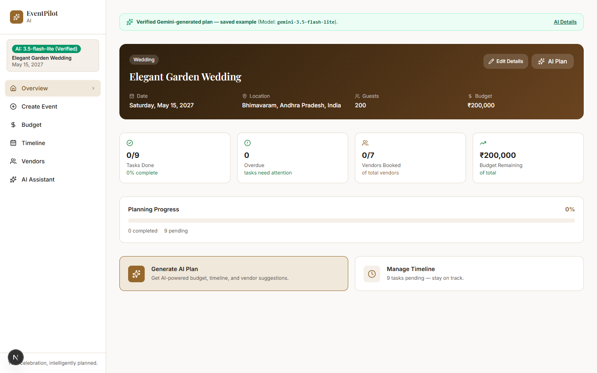
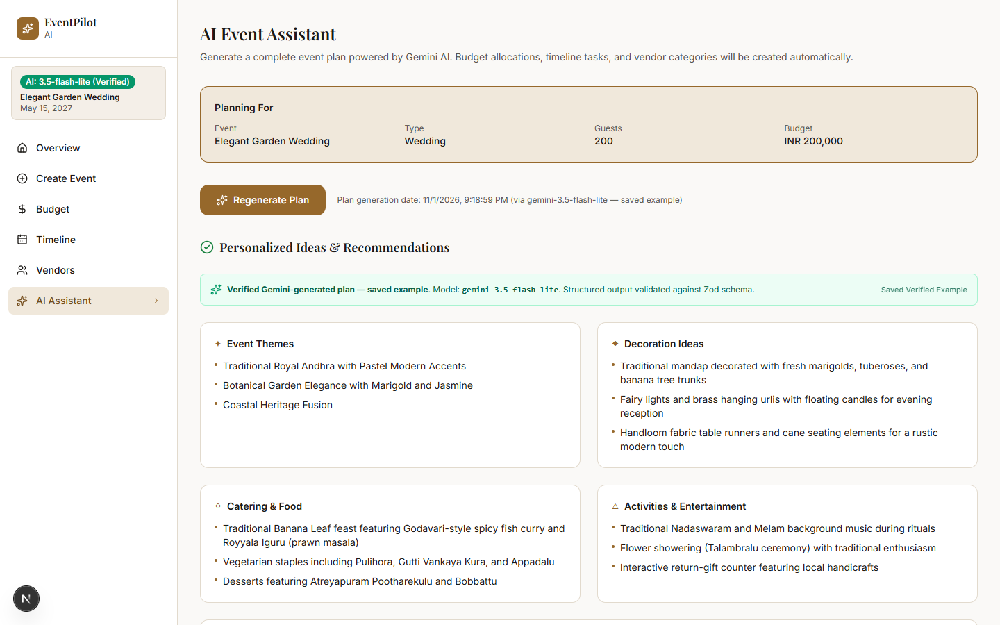
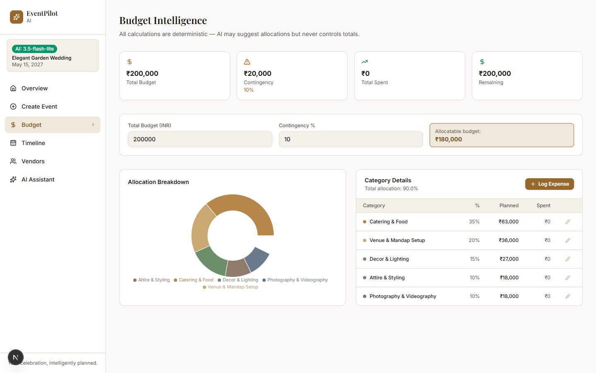
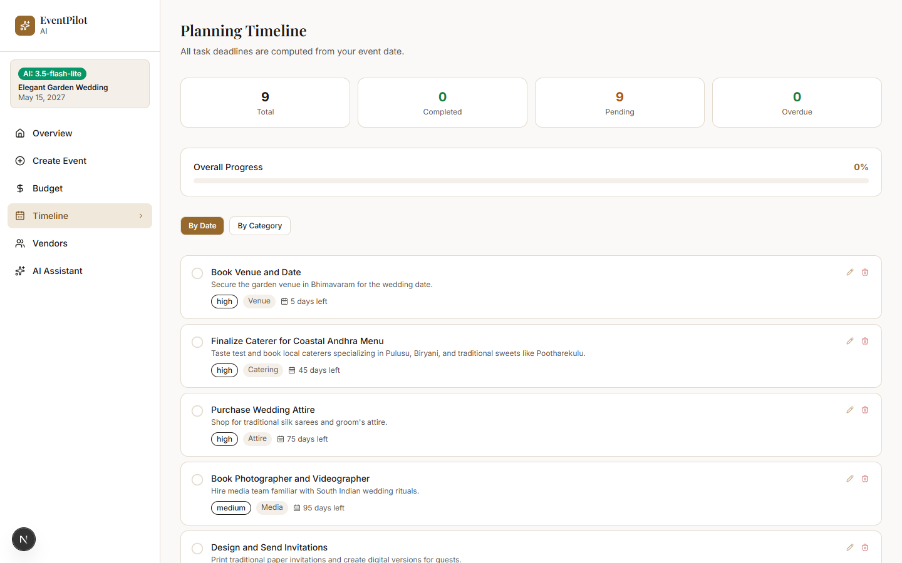
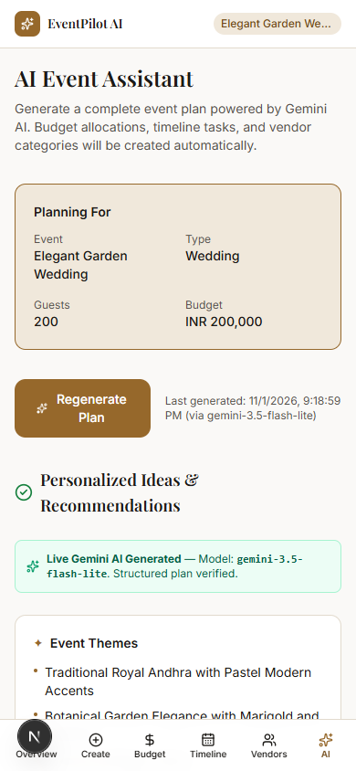

# EventPilot AI

**Your celebration, intelligently planned.**

EventPilot AI is an intelligent event planning and management platform designed for weddings, birthdays, community gatherings, and milestone celebrations. By uniting Google Gemini's generative intelligence with a deterministic financial and temporal calculation engine, EventPilot AI transforms high-level event concepts into actionable, stress-free execution plans.

---

## 1. Problem Statement

Planning an event—whether a 200-guest traditional wedding or an intimate community gathering—is notoriously chaotic. Planners and hosts routinely face:
- **Budget Uncertainty & Math Errors**: Generic budget percentages that fail to add up to 100% or don't respect local market realities.
- **Scattered Execution**: Timelines disconnected from actual event dates, leading to last-minute vendor rushes and missed booking deadlines.
- **Vague Recommendations**: Generic AI advice that lacks cultural specificity, geographic grounding, or actionable vendor categories.
- **Fragile Cloud AI Dependencies**: Event planners cannot afford downtime or unhandled 503 service outages in the middle of on-site coordination.

---

## 2. Solution Overview

EventPilot AI bridges generative creativity and computational rigor:
1. **Adaptive GenAI Planning**: Generates customized planning blueprints, cultural concepts, catering ideas, and vendor categories tailored to exact guest counts, themes, and regional contexts.
2. **Deterministic Financial Engine**: Guarantees that every rupee, dollar, or euro is accounted for—ensuring budget categories total exactly 100% with zero floating-point drift.
3. **Date-Anchored Timeline**: Automatically schedules planning milestones backwards from the event date, highlighting overdue, upcoming, and critical-path tasks.
4. **Resilient 3-Model Cascade**: Employs an automated failover strategy across Google Gemini models to safeguard uptime even during upstream provider congestion.
5. **Honest Provenance & Transparency**: Explicitly distinguishes between fresh live AI generation, saved verified AI plans, and offline demo templates.

---

## 3. Core Features

- **Personalized AI Blueprint**: Dynamic event plan generation covering theme execution, styling palettes, catering recommendations, and interactive activity programs.
- **Deterministic Budget Intelligence**:
  - Live allocation gauges and visual spending distribution charts.
  - Category-by-category breakdown with exact target calculation and remaining funds tracking.
  - Guardrails preventing mathematical discrepancies.
- **Milestone Timeline Generator**:
  - Automatically calculates milestone dates relative to event day (e.g., 6 months out, 1 month out, week-of, day-of).
  - Status tracking with one-click completion toggles and overdue alerts.
- **Vendor Category Tracker**:
  - Organizes vendors across key specialties (Venue, Catering, Photography, Decor, Entertainment, Attire).
  - Tracks quote estimates, contact details, and booking status.
- **Dual-State Persistence**:
  - Client-side storage layer for privacy and offline persistence.
  - Zero lock-in: instant switching between demo templates and verified AI events.
- **Warm Neutral Premium UI**:
  - Built with a modern warm-stone aesthetic, accessible contrast ratios, and responsive layouts optimized for desktop (1200px max container) and mobile viewports.

---

## 4. Visual Walkthrough

### Desktop Experience (1200px Balanced Layout)

| Overview Dashboard | AI Assistant Tab |
|---|---|
|  |  |

| Budget Intelligence | Timeline & Vendor Management |
|---|---|
|  |  |

### Mobile Experience (390×844)

<p align="center">
  
</p>

---

## 5. Technology Stack

- **Framework**: [Next.js 16](https://nextjs.org/) (App Router, Turbopack, React 19)
- **Language**: TypeScript 5 (Strict type-checking across all components and server routes)
- **Styling**: Tailwind CSS 4 with custom warm neutral color tokens
- **AI SDK**: `@google/genai` (Official Google GenAI SDK, server-side execution only)
- **Runtime Validation**: [Zod](https://zod.dev/) (Strict contract-first schemas for all inbound requests and outbound AI outputs)
- **State Management**: [Zustand](https://github.com/pmndrs/zustand) with custom localStorage persistence
- **Visualizations**: [Recharts](https://recharts.org/) for responsive budget breakdown charts
- **Icons**: [Lucide React](https://lucide.dev/)
- **Testing**: [Vitest](https://vitest.dev/) (92 automated unit and integration tests)

---

## 6. Architecture & System Design

```
eventpilot-ai/
├── app/
│   ├── api/generate-plan/route.ts   # Server-side Gemini AI orchestration & fallback cascade
│   ├── layout.tsx                   # Root HTML shell & meta configuration
│   ├── page.tsx                     # Main client shell & responsive viewport constraints
│   └── globals.css                  # Global Tailwind 4 stylesheet & accessibility styles
├── components/
│   ├── Sidebar.tsx                  # Desktop navigation & live status indicators
│   ├── Header.tsx                   # Top app bar & event quick-switcher
│   ├── tabs/
│   │   ├── HomeTab.tsx              # Executive event overview & key metrics
│   │   ├── AIAssistantTab.tsx       # AI prompt form, live stream feedback, & recommendations
│   │   ├── BudgetTab.tsx            # Deterministic budget manager & interactive charts
│   │   ├── TimelineTab.tsx          # Date-anchored milestone timeline with progress meter
│   │   └── VendorsTab.tsx           # Vendor tracking by category & booking stage
├── lib/
│   ├── schemas.ts                   # Canonical Zod schemas (API contract & AI output)
│   ├── budget.ts                    # Deterministic financial math (100% allocation guarantee)
│   ├── timeline.ts                  # Date calculations & relative milestone scheduler
│   ├── persistence.ts               # LocalStorage serialization & schema hydration
│   ├── demo-plan.ts                 # Pre-built fallback template for offline demo mode
│   └── demo-data.ts                 # Sample Sarah & James wedding dataset
├── store/
│   └── appStore.ts                  # Central Zustand state store
├── docs/
│   ├── screenshots/                 # High-resolution desktop & mobile UI captures
│   └── PHASE_*.md                   # Engineering, security, and verification audit logs
└── __tests__/
    ├── api-contract.test.ts         # Zod contract validation tests
    ├── budget.test.ts               # Deterministic budget calculation tests
    ├── timeline.test.ts             # Timeline milestone & date tests
    └── model-resilience.test.ts     # Multi-model cascade & timeout failover tests
```

---

## 7. AI Resilience & Multi-Model Fallback Cascade

EventPilot AI implements an enterprise-grade failover cascade to guard against upstream AI provider rate limits, regional congestions, and temporary service outages:

```
                  ┌───────────────────────────────┐
                  │   User Requests Event Plan    │
                  └───────────────┬───────────────┘
                                  │
                                  ▼
                    [1. Primary Model Attempt]
                         gemini-3.8-flash
                     (12-second abort timeout)
                                  │
                 ┌────────────────┴────────────────┐
                 │ Success                         │ Timeout / 503 / Transient Error
                 ▼                                 ▼
          ┌─────────────┐            [2. Secondary Model Fallback]
          │ Return Plan │                  gemini-3.6-flash
          └─────────────┘              (15-second abort timeout)
                                                   │
                                  ┌────────────────┴────────────────┐
                                  │ Success                         │ Timeout / 503 / Transient Error
                                  ▼                                 ▼
                           ┌─────────────┐             [3. Tertiary Model Fallback]
                           │ Return Plan │                gemini-3.5-flash-lite
                           └─────────────┘               (18-second abort timeout)
                                                                    │
                                                   ┌────────────────┴────────────────┐
                                                   │ Success                         │ Exhausted
                                                   ▼                                 ▼
                                            ┌─────────────┐            ┌───────────────────────────┐
                                            │ Return Plan │            │ Controlled HTTP 504 / 503 │
                                            └─────────────┘            └───────────────────────────┘
```

1. **Primary Model (`gemini-3.8-flash`)**: High-fidelity reasoning with structured JSON response schema enforcement.
2. **Secondary Fallback (`gemini-3.6-flash`)**: Triggered immediately upon 503 UNAVAILABLE or primary abort timeout.
3. **Tertiary Fallback (`gemini-3.5-flash-lite`)**: Low-latency, high-throughput model optimized for structured JSON generation.
4. **Structured Output Guarantee**: Every upstream response is strictly validated against `generatedPlanOutputSchema` before reaching the client.
5. **No Client Silent Failures**: All transient network drops and timeouts return structured, actionable error codes (`UPSTREAM_TIMEOUT`, `MODEL_UNAVAILABLE`).

---

## 8. Deterministic Financial & Timeline Engines

### Budget Engine (`lib/budget.ts`)
- **100% Allocation Invariant**: Ensures that total allocated percentages across all categories sum to exactly 100%. The final category absorbs any fractional rounding remainder.
- **Zero Floating-Point Drift**: All currency amounts are rounded using deterministic whole-unit calculations.
- **Over-Budget Warnings**: Dynamically computes actual vs. target spending, flagging discrepancies immediately.

### Timeline Engine (`lib/timeline.ts`)
- **Relative Date Scheduling**: Milestone tasks are generated using relative offsets (e.g., `-180` days for venue booking, `-30` days for RSVPs, `0` for day-of coordination).
- **Date Arithmetic**: Clean calendar date offsets computed without timezone skew.
- **Progress Tracking**: Real-time completion percentages and overdue status indicators.

---

## 9. Getting Started

### Prerequisites
- Node.js 18.18+ or 20+ (tested on Node.js v20/v22)
- npm or pnpm

### 1. Clone and Install

```bash
git clone https://github.com/pavanravindrakumar/eventpilot-ai.git
cd eventpilot-ai
npm install
```

### 2. Environment Configuration

Copy the example environment file:

```bash
cp .env.example .env.local
```

Open `.env.local` and add your Google Gemini API key:

```env
GEMINI_API_KEY=your_actual_gemini_api_key_here
```

> **Where to get a key:** Obtain a free Gemini API key from [Google AI Studio](https://aistudio.google.com/).

### 3. Demo Mode vs. Live AI Mode

- **Without an API Key**: The application automatically runs in **Demo Mode**. You can explore a fully populated sample wedding event ("Sarah & James Wedding") with realistic budget and timeline data. Demo content is clearly labeled so no mock data is ever misrepresented as live AI output.
- **Verified Saved AI Plan**: The initial run includes an option to inspect a genuine, previously validated Gemini AI plan (for a 200-guest wedding in Bhimavaram, AP), complete with Zod verification metadata.
- **With an API Key**: Generating a plan triggers the real Gemini multi-model cascade, producing a customized, schema-validated plan in real time.

---

## 10. Local Development & Quality Scripts

```bash
# Start local development server with Turbopack (http://localhost:3000)
npm run dev

# Run comprehensive automated test suite (92 tests)
npm test

# Run TypeScript compiler check (zero errors allowed)
npx tsc --noEmit

# Run ESLint linter
npm run lint

# Build optimized Next.js production bundle
npm run build

# Start production server locally
npm start
```

---

## 11. Security Considerations

- **Server-Side Key Isolation**: `GEMINI_API_KEY` is read strictly within server route handlers (`app/api/generate-plan/route.ts`). It is never bundled into client JavaScript, exposed to the browser, or logged.
- **Zero Secrets in Git**: `.env.local` is strictly excluded via `.gitignore`. Automated secret scanning has verified that no private API keys exist in git history or tracked code.
- **Contract-First Input Sanitization**: All inbound user inputs (guest count, budget, location, theme) are validated against strict Zod constraints (preventing negative budgets, non-numeric guests, or prompt injection exploits).
- **Safe Output Rendering**: AI-generated suggestions are rendered as sanitized text nodes, avoiding `dangerouslySetInnerHTML`.

---

## 12. Deployment Instructions

> **Note**: This repository contains the complete, verified release codebase. A live production deployment has not yet been launched and can be deployed with one click to Vercel:

1. Fork or push this repository to GitHub.
2. Sign in to [Vercel](https://vercel.com) and click **"Add New Project"**.
3. Import your `eventpilot-ai` repository.
4. In **Project Settings → Environment Variables**, add:
   - **Key**: `GEMINI_API_KEY`
   - **Value**: `your_actual_gemini_api_key`
5. Click **Deploy**. Vercel will run `npm run build` and launch the application on edge-optimized infrastructure.

---

## 13. Future Roadmap

- **Collaborative Planning**: Multi-user shared planning rooms with real-time sync via WebSockets.
- **Direct Vendor RFP Dispatch**: Automated email inquiry drafting directly from vendor category cards.
- **Export & Integrations**: One-click export to Google Sheets, PDF run-sheets, and calendar `.ics` milestones.
- **Voice-Assisted Itinerary Builder**: Real-time voice interaction powered by the Gemini Live API for hands-free event day coordination.

---

## 14. License

This project is licensed under the MIT License. See [LICENSE](LICENSE) for details.
